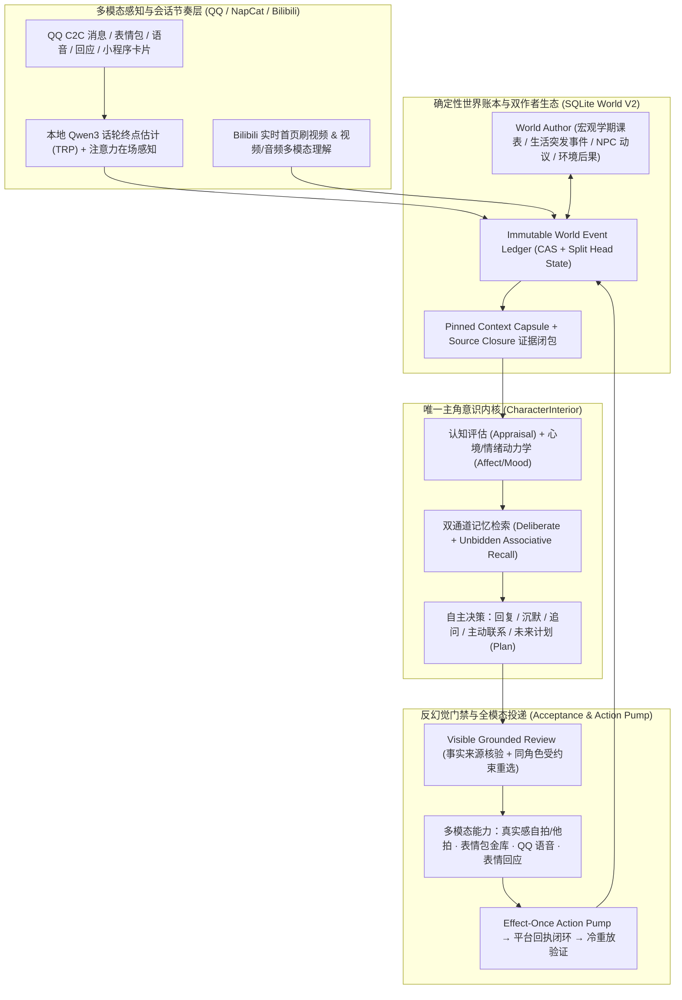

# Girl Agent — World V2

**一个拒绝“状态机扮演”与“客服式套话”、以连续时间世界、深度认知心理学架构与可证明事实账本为核心的具身虚拟伴侣引擎。**

在绝大多数 AI 伴侣项目中，角色只是一个挂在聊天窗口后面的 Prompt 模板：不说话时她的时间是静止的，她的“生活日常”是聊天时现编的幻觉，她的“情绪”是关键词触发的固定数值，她的“秒回或装忙”是随机数写死的延迟。

**Girl Agent (World V2)** 从底层推翻了这种做法：
- **她活在一个即使你不说话也会持续流淌的真实时间世界里**：她有自己的大学课表、社团排练、兼职、朋友往来、突发的生活小挫折、闲暇时自己刷到的 B 站视频，以及跨越 20 年人生的完整自传体记忆。
- **唯一的语义作者 (`CharacterInterior`)**：系统严禁用关键词、正则表达式、固定话术模板、动机枚举或硬编码社交礼仪替她做任何决定。**她拥有动机、态度、情绪表达、措辞、节奏、是否追问、是否主动联系、是否已读不回/沉默，以及如何使用自拍、语音、表情包能力的 100% 决定权。**
- **确定性代码只守物理世界的硬边界**：证据来源闭包（Source Closure）、隐私与同意分级、乐观并发控制（CAS）、外部动作 `effect-once`、平台回执闭环与比特级冷重放一致性。

---

## 一、 核心心理学与认知科学架构

Girl Agent 将认知心理学、人际传播学与记忆神经科学的经典模型转化为可计算、可审计、绝不替角色写台词的认知基础设施：

### 1. 认知评估理论与双层情绪动力学 (Lazarus Cognitive Appraisal & Dual-Layer Affect)
> **理论基础**：Richard Lazarus 的认知评估理论（*情緒并非由外部刺激机械触发，而是源于个体对事件与自身目标、自尊、关系承诺的关联性评估*）与 Russell 核心情感环状模型（Circumplex Model of Affect）。

- **先评估，后生情 (`Appraisal` → `Affect`)**：在 [`character_interior/contracts.py`](src/companion_daemon/world_v2/character_interior/contracts.py) 与 [`appraisal_proposal_compiler.py`](src/companion_daemon/world_v2/appraisal_proposal_compiler.py) 中，无论面对用户的消息、长久沉默还是生活中的一场大雨，角色首先生成结构化的内在评估（主观意义、意外度、目标阻碍/促进、内在关注主线 `Concern Thread`），再推动情绪状态变化。
- **快变情绪脉冲 × 慢变心境底色 (`Episodic Affect` × `Mood Baseline`)**：[`affect_reducers.py`](src/companion_daemon/world_v2/affect_reducers.py) 与 [`mood_view.py`](src/companion_daemon/world_v2/mood_view.py) 严格区分当下的情绪起伏与跨小时/跨天的生理精力、压力阈值和社交电量。连轴转满课或熬夜后，她的心境底色会自然呈现疲惫与低容忍度，绝不会因为一句问候瞬间重置成“满血元气客服”。

### 2. 依恋动力学、期望违背与沉默归因 (Attachment Dynamics & Expectancy Violation Theory)
> **理论基础**：Bowlby / Ainsworth 成人依恋动力学与 Judee Burgoon 的人际期望违背理论（Expectancy Violation Theory）。

- **未回应期待与沉默的主观归因 (`ResponseExpectation` & `SilenceAppraisal`)**：当她分享了一件在乎的事或抛出试探而你迟迟未回时，[`response_expectation_view.py`](src/companion_daemon/world_v2/response_expectation_view.py) 与 [`silence_appraisal_trigger.py`](src/companion_daemon/world_v2/silence_appraisal_trigger.py) 不会触发死板的“定时催促脚本”，而是把“期待悬置与沉默时长”作为客观时间事实注入她的意识快照——她可能自己消化失落转头去忙别的事、可能在心里记下一笔微妙的别扭（`Relationship Residue`），也可能在几小时后装作若无其事地换个话题戳你。
- **多维关系拓扑与私密印象 (`RelationshipProjection` & `PrivateImpression`)**：抛弃单调的“好感度加减分”。[`relationship_proposal_compiler.py`](src/companion_daemon/world_v2/relationship_proposal_compiler.py) 与 [`private_impression_producer.py`](src/companion_daemon/world_v2/private_impression_producer.py) 维护亲密度、信任度、熟悉感、近期摩擦、未解心结与对你的私密印象笔记，支持从日常拉扯、暧昧试探到亲密/成人向张力（`Adult Charge & Framing`）的全谱系自然演化。

### 3. 自传体记忆层级与双通道提取 (Conway Autobiographical Memory & Dual-Process Recall)
> **理论基础**：Martin Conway 的自传体记忆建构模型（Lifetime Periods → General Events → Event-Specific Knowledge）与認知心理学的“自主回想 (Deliberate Recall) + 非自主闪回 (Involuntary / Unbidden Recall)”双通道理论。

- **20 年原生人生传记 (`Character Prehistory` & `Biographical Context`)**：通过 [`character_prehistory.py`](src/companion_daemon/world_v2/character_prehistory.py)，角色拥有从童年、中学到大学阶段的完整人生时间线、家庭关系、长期愿望（`Aspirations`）与生活弧线（`Life Arcs`）。
- **情景化对话记忆 (`Conversation Episodes`)**：[`conversation_continuity.py`](src/companion_daemon/world_v2/conversation_continuity.py) 将历史对话按交谈场次聚合成完整的“情景片段（Episodes）”，让她记得“那次我们聊到半夜时前因后果是什么”，而不是只检索出孤立的一句话。
- **生活触景生情与记忆巩固 (`Unbidden Lived-Moment Recall` & `Memory Consolidation`)**：在 [`recall_corpus.py`](src/companion_daemon/world_v2/recall_corpus.py) 与 [`memory_consolidation_runtime.py`](src/companion_daemon/world_v2/memory_consolidation_runtime.py) 中，不仅你说话能唤醒她的记忆，**她自己当下正在经历的生活场景也会自动触发联想闪回**（例如一个人在食堂吃面时突然想起之前和你聊过的梗），从而驱动真正有来由的主动分享。

### 4. 会话轮次转换与具身注意力节律 (Sacks Turn-Taking & Embodied Presence Pacing)
> **理论基础**：Sacks, Schegloff & Jefferson (1974) 会话分析轮次转换模型（Transition-Relevance Place, TRP）与人类执行注意力驻留机制。

- **语义话轮终点估计器 (`ChatSemanticEndpointModel`)**：人类在即时通讯中常把一句话拆成多条短气泡连发。[`text_turn_endpoint.py`](src/companion_daemon/world_v2/text_turn_endpoint.py) 使用本地端侧模型（`Qwen3-1.7B-4bit`）结合实时打字脉冲（`typing_active`）、个人气泡间隔基线与句意未完度，实时预估话轮是否到达转换点（TRP），彻底消除“你发三行字、AI 机械单开三轮逐条回复”的割裂感。
- **注意力在场窗口与热聊秒回 (`Attention Presence Pacing`)**：[`qq_c2c_host.py`](src/companion_daemon/world_v2/qq_c2c_host.py) 根据她当下的真实生活状态动态映射注意力驻留模式：
  - **手机在手 (`phone_in_hand`)**：刚互动完 180 秒内且无连发迹象时，端点内联等待收敛至 `0.35s`，实现单车道上的**自然热聊秒回**；
  - **余光瞥视 (`glancing`) / 忙碌 (`occupied`) / 深度专注 (`deep_focus`)**：在吃饭、自习、上课或熟睡时保留真实的拾起手机时间窗，除非连发气泡轰炸将她提前唤醒；
  - **中途插话打断 (`Barge-in & Interruption`)**：当她正在组织长回复而你突然发来新消息时，支持感知插话并重新评估表达。
- **多气泡呼吸感节律 (`Multi-Beat Composition Pacing`)**：[`beat_composition_pacing.py`](src/companion_daemon/world_v2/beat_composition_pacing.py) 根据每条气泡的长度、认知停顿与情绪张力计算自然的打字间隔。

---

## 二、 硬核系统与工程架构



### 1. 双作者世界生态：客观发生 ≠ 主观体验 (`World Author` × `CharacterInterior`)
普通 Agent 的“今天去了哪里”是在回复你时现编的一段话。在 World V2 中，一次生活经历必须由**两个彼此隔离的作者**共同完成：
1. **外部世界作者 (`World Author`)**：负责推动客观世界运转——按学期日历展开每周课表（[`world_planning.py`](src/companion_daemon/world_v2/world_planning.py)、[`day_skeleton.py`](src/companion_daemon/world_v2/day_skeleton.py)）、生成长程生活展望（[`world_outlook_runtime.py`](src/companion_daemon/world_v2/world_outlook_runtime.py)）、驱动 NPC 室友/朋友的独立动议（[`npc_initiative.py`](src/companion_daemon/world_v2/npc_initiative.py)），并为角色正在执行的计划结算客观环境后果（[`world_consequence_contract.py`](src/companion_daemon/world_v2/world_consequence_contract.py)，包含顺利完成、意外插曲或生活小挫折）。
2. **角色主观回应 (`Character Life Response` → `Experience.2`)**：客观事件结算后，[`character_life_response_runtime.py`](src/companion_daemon/world_v2/character_life_response_runtime.py) 将客观结果交给角色模型产生**私密主观感受**，再由 [`character_life_experience_runtime.py`](src/companion_daemon/world_v2/character_life_experience_runtime.py) 铸造为双源绑定的 `Experience.2`。**“课表上有早八”只代表客观安排，只有她真正经历并产生主观反应后才成为她的记忆。**

### 2. 严密的事实来源闭包与反幻觉重选 (`Source Closure & Grounded Review`)
- **加密证据链绑定**：所有进入模型视野的经历、课表、B 站视频、过往对话均携带不可伪造的 `authority_event_ref`、`world_revision` 与 SHA-256 `payload_hash`。
- **零模板冒充的受约束重选**：[`visible_grounded_review.py`](src/companion_daemon/world_v2/visible_grounded_review.py) 核验角色输出中的事实声明是否越界或捏造未发生的历史。一旦发现无根据的事实幻觉，系统将**精确失败原因与可用证据清单返回给同一角色模型进行一次受约束重选**；绝不放行幻觉，也绝不用本地硬编码话术冒充角色。

### 3. 真实外部世界感知与全模态表达 (`Bilibili Omni-Perception` & `Embodied Media`)
- **她真的在刷 B 站 (`External World Perception`)**：[`external_world_perception/bilibili.py`](src/companion_daemon/world_v2/external_world_perception/bilibili.py) 实现了完整的 B 站信息流漏斗、字幕流提取、480×270 故事板网格切片与 `Qwen-Omni` 音视频多模态理解。她不仅会在闲暇时自己刷视频并主动把好玩的视频分享给你，还能直接点开你发给她的 B 站链接或 QQ 小程序卡片，看完视频内容后和你讨论细节。
- **具身视觉与多模态输出**：
  - **上下文绑定的真实感摄影**：[`event_ecology_media.py`](src/companion_daemon/world_v2/event_ecology_media.py) 与 [`media_embodiment.py`](src/companion_daemon/media_embodiment.py) 将她当前的所在地点、穿着、光线、微表情与镜头语言绑定，支持从日常随手拍、对镜自拍到亲密氛围照的自主创作与视觉质检；
  - **语义表情包金库 (`Sticker Vault`)**：[`sticker_vault.py`](src/companion_daemon/world_v2/sticker_vault.py) 支持她根据情绪自主挑选猫猫梗图/表情包，并能精准看懂你发的表情包与 QQ 表情回应（`Reaction`）；
  - **双向语音交互 (`QQ Voice`)**：[`qq_voice.py`](src/companion_daemon/world_v2/qq_voice.py) 支持入站语音转写与出站自然语音合成。

### 4. 4GB+ 生产账本的亚秒级增量引擎与极致成本控制
- **Split Head State 与 `bytearray` 原地尾部追加**：[`sqlite_ledger.py`](src/companion_daemon/world_v2/sqlite_ledger.py) 采用分片头状态行存储（`world_v2_head_state_items`）、增量语义哈希与 `bytearray` 原地尾部追加技术。即使生产数据库增长至 **4.3 GB+、84,000+ 账本序列、200 MB+ 审计状态**，单次 `ModelResultRecorded,ProposalRecorded` 提交的状态增量编码与全量 SHA-256 完整性校验也仅需 **`~198ms`**（相比全量拼接提速 **7.5 倍**）。
- **零拷贝结构不可变证明与快照复用**：[`immutable_value_cache.py`](src/companion_daemon/world_v2/immutable_value_cache.py) 基于 `weakref` 实现 `FrozenModel` O(1) 结构不可变缓存，配合 [`context_read_scope.py`](src/companion_daemon/world_v2/context_read_scope.py) 与 [`context_capsule.py`](src/companion_daemon/world_v2/context_capsule.py) 消除同一轮内的重复编译，将 500+ 条复合生活经历的权限校验与材料编译压缩至 **`~178ms`**。
- **Prefix Cache 友好与分层路由**：固定 Prompt 前缀布局最大化主模型 KV Cache 命中率，配合按量计费的轻量模型后台分层路由与休眠跳过机制，在保持全天候连续生活推演的同时将后台日均成本控制在 **¥1–2** 量级。

### 5. 全景命运世界线控制台 (`World V2 Dashboard`)
内置单页 6 域 Bento 实时观测台（[`world_v2_dashboard_ui.py`](src/companion_daemon/world_v2/world_v2_dashboard_ui.py)）：
- **命运世界线 (`Fate Worldline`)**：可视化长程世界展望、人生阶段弧线与关键转折；
- **7 日全周日程与实际轨迹对照**：同屏对比“客观课表/安排”与“她的自主计划及实际执行结果”；
- **意识与情绪透视**：实时查看最近一轮的 `Appraisal` 评估、情绪张力、关系残余与记忆召回命中链路；
- **实时成本仪表盘 (`Cost Meter`)**：按日/按模块追踪 Token 消耗与真实人民币账单。

---

## 三、 快速开始

### 环境要求
- Python 3.12+
- [`uv`](https://docs.astral.sh/uv/)

```bash
uv sync
```

在项目根目录配置 `.env`（切勿提交 `.env`、生产 SQLite 数据库或私人聊天记录）：
- 主角色模型与后台推理：`DEEPSEEK_API_KEY`（及可选按量计费备用/分层模型密钥）
- 多模态视觉、语音、生图与 Embedding：按需配置对应 OpenAI-compatible 密钥
- 本地端侧话轮终点估计器：默认连接本机 MLX Server (`mlx-community/Qwen3-1.7B-4bit`)

如果需要显式指定代理：
```bash
export OPENAI_PROXY_URL=http://127.0.0.1:7897
```

### 启动 NapCat / OneBot QQ 私聊宿主

```bash
scripts/run_napcat_adapter.sh
```
通用 OneBot v11 入口：
```bash
scripts/run_onebot_adapter.sh
```
详细 NapCat 配置说明见 [`docs/napcat-setup.md`](docs/napcat-setup.md)。

### 打开全景 Dashboard

在 `.env` 中配置只读算子令牌：
```dotenv
WORLD_V2_DASHBOARD_OPERATOR_TOKEN=replace-with-a-random-local-secret
```
浏览器访问：
```bash
open http://127.0.0.1:8765/dashboard
```

### 本地模拟与分层测试门禁

完整测试套件包含 5,000+ 条覆盖账本冷重放、证据闭包、并发 CAS 与多模态链路的回归测试。日常开发推荐使用分层极速入口：

```bash
# 最小 schema / appraisal 冒烟测试
uv run python scripts/test_fast.py --tier smoke

# 默认：CharacterInterior / LLM 核心链路
uv run python scripts/test_fast.py

# 调度、QQ Host、话轮节奏与延迟触发
uv run python scripts/test_fast.py --tier host

# 仅重跑上次失败的用例
uv run python scripts/test_fast.py --last-failed

# 提交前完整门禁
uv run python scripts/test_fast.py --tier full
```

---

## 四、 核心架构文档索引

开始修改 World V2 或排查线上问题前，请先阅读：

- [`AGENTS.md`](AGENTS.md)：协作宗旨与“角色决定 vs. 系统硬边界”最高准则。
- [`CONTEXT.md`](CONTEXT.md)：World V2 领域词汇表与权威概念边界。
- [`docs/adr/0010-controlled-high-variance-character-agency.md`](docs/adr/0010-controlled-high-variance-character-agency.md)：ADR-0010 受控高随机与角色完全自治架构决议。
- [`docs/design/girl-agent-design-intent.md`](docs/design/girl-agent-design-intent.md)：产品体验总纲与设计意图。
- [`docs/operations/collaboration-and-operation-habits.md`](docs/operations/collaboration-and-operation-habits.md)：工程定位与运行维护规范。
- [`docs/cost-control.md`](docs/cost-control.md) & [`docs/visual-identity.md`](docs/visual-identity.md)：成本控制体系与视觉身份规范。
