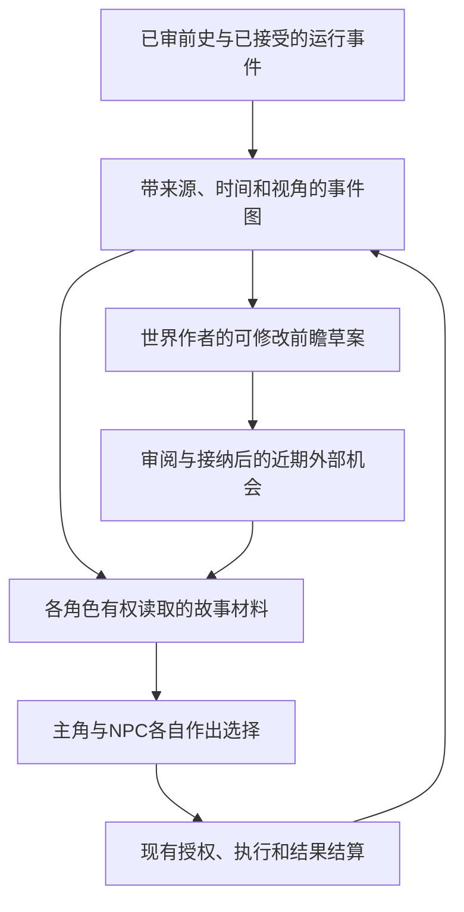

# 长期故事系统：当前断点与实施方案

2026-10-07，基于候选`759b59b5`。**这是待讨论的设计与实施顺序，本轮未新增运行机制、未导入前史、未调用付费模型。**用户目标是有长期因果、人物变化、多线交织和持续后果的生活；上一轮12个场景扩充只补内容覆盖，不足以验证此目标。

结论：先写连贯前史再转换为个人经历的方向合理；当前应优先补“语义结构保留—有权限地重组—多线一致—真实结果接续”四个环节。现有代码可作为基础，尚不能保证长篇故事重建、跨小说无矛盾或数周生活达到离线精修稿的系统性。

主要证据：[导入与连续性审计](../audits/narrative-import-continuity-2026-10-07.md)、[一手研究及适用边界](../research/long-horizon-story-system-2026-10-07.md)、[既有人生/NPC设计](life-history-narrative-and-npc-handoff-2026-09-29.md)。以下区分代码事实与建议。

## 1. 对四个问题的直接回答

| 问题 | 当前能力与证据 | 尚待完成 |
|---|---|---|
| 角色能把片段串成完整故事吗 | 有原文、材料块、关系提议、来源审阅、活跃记忆图遍历；同轮真实输入出现过照片故事的五节点链，并产生相关回应；未做有/无故事因果对照 | 不能据此证明整部长篇理解。旧样本一个节点只有480字符窗口；当前最多6个hits、有字节上限，缺少按阶段/知情变化组装和分步展开的完整故事读取 |
| 多个长期故事会不会冲突 | 同ID实体/记录不可悄悄改写；独立审阅会对照提交的既有档案检查语义冲突 | 同事件换ID仍可能重复；没有完整的跨故事事件身份归并、事实版本与并发增量接纳流程 |
| 小说→片段是否可复现 | 已有捕获响应恢复、run指纹检查、审核绑定、重复导入幂等；run-10产物可重建 | run-10是4582字符短篇、多轮修订后的成功样本；不能证明重新调用模型的语义结果稳定，也未证明长篇自动分章合并 |
| 未来生活能否同样系统化 | 已有World Author、CharacterInterior、NPC选择、Plan/Activity/Occurrence/Experience、LifeArc及传记情境 | 缺一条跨这些模块、长期维护未决事项和因果后果的可重建故事视图，以及受选择影响持续修订的前瞻；无数周多线叙事质量验收 |

最近24小时虚拟日的11个世界事件、3次活动开始/3次放弃只是一份运行记录，不证明长期生活丰富或贫乏。没有完成活动也不能直接判为角色选择错误；需要查看后果、技术失败与后续条件是否正确持续。

## 2. 两个概念的建议定义

### 世界树：一张带类型、视角和版本的事件图

“世界树”可作为人的导航界面，底层应允许多父关系和跨线连接。一次搬迁可以同时影响工作、友情、住处和经济条件；多个人对同一事件也有不同理解。树形唯一父节点会重复事件或丢掉交叉联系。

一张图中至少区分：

- **源材料与事件**：完整原文/版本/精确文本位置、稳定事件身份、人物、发生时间范围、可观察行动与后果。
- **个人所知**：谁亲历、看见或被告知，何时起知道，来源是何条观测/转述；参与同一事件不自动共享内心。
- **个人理解**：当时的误解、现在的解释与后来的修订，继续由相应角色拥有；它们可相互矛盾而非事实冲突。
- **长期事情**：尚未结束的合作、约定、资源变化、实际目标/承诺及已留下的后果。其有效事实回指已有Plan、Commitment、Aspiration、LifeArc等，不让图索引另签一份事实。
- **关系边**：同场景、先后、明确后续、后来告知、明确回扣，以及有充分来源的前提/结果联系。关系标签描述证据，不是情绪或动机枚举；时间先后、同一人物和语义相似不能直接产生因果。

节点的事实地位由原始接受记录决定；图是可重建的阅读视图。原小说、全知创作底稿、主角可读子图、NPC私有子图分别受权限约束。前瞻草案不能进入已发生历史的检索集合。暂不引入第二套事实数据库或为此先换图数据库。

### 命运：随实际选择修订的世界前瞻

建议把“命运”落实为World Author使用的、非事实的滚动发展草案：保存现状依据、长期未决问题、可发生的外部变化、成立条件、涉及的来源版本、有效期及修订原因。

远处只保存粗略问题和可能相交的条件，近处才形成可验证的具体机会。草案不成为角色已经接受的Plan，也不成为已生效的LifeArc。世界作者不能写主角或NPC必须持有的动机、情绪、决定和成长终点；NPC自己的打算仍由NPC作者提出。

接受、拒绝、延期和不参与都可让原前瞻变化。若当事人以后主动改观，可以形成新的选择；系统不能在缺乏新依据时反复改名投放同一压力，把所有路径拉回预定结局。过去不可因改纲而变动，未来草案可以过期、替换或归档。技术失败不是角色拒绝。

## 3. 当前代码最重要的断点

### 中间材料丰富，正式档案被压平

`LifeMaterialBlock`已有event_ref、kind、source_quote/locator、allowed_actor_refs和可选事件时间；`LifeRecollection`有known_from/until。`PrehistoryStoryRelation`已有shared_scene、episode_followup、later_disclosure、explicit_callback及两端/桥接证据。

但`apply_story_links()`把关系转换成双向`related_record_refs`；`export_actor_archive()`把known时间填入旧PrehistoryRecord的occurred字段，真正事件时间放在正文。正式读取不会自动加载原rich materials与typed关系。这使运行层难以确定性回答“何时发生”和“当时谁已知道”，也不能可靠区分后续、披露与一般相关。

修复方向是版本化保留这些信息并接入真实reader。旧档案和旧回执保持原语义；从旧正文补建结构须有原文支持和独立审阅，未知时间/身份继续未知，不从相邻ID猜因果。

### 可检索邻接不等于可阅读整条经历

`recall_index.py`现在从一个锚点作有界BFS，目标必须活跃、属于该actor且可读。它已超过单纯top-k和一跳关联，但默认关联节点仍可能只带首个窗口。hybrid.14的完整父记录替换仅适用于≤1024字符、预算允许的前史。

下一步应提供：相关事件的前提、本人行动/体验、实际后果、后来获知和当前理解；按问题必要性读取，允许继续展开。在预算不够时返回可审计的部分覆盖状态，不能把拿到6个片段称为整条故事完整。角色可见的覆盖说明也不能泄露无权知道的私有节点。

“现在回看当年”和“以当年所知作判断”必须是不同读取视角。后者按knowledge_as_of排除后来披露与后来形成的理解，而非把未来材料交给模型后要求它假装不知道。

### 长期情境已经存在，尚非长期叙事管理

生产构造器确实接入了`LifeDevelopmentRuntime`、`BiographicalLifecycleRuntime`、`NpcEcology`与单一`LifeEcologyRuntime`。`compile_pressure_surfaces()`提供活跃计划、盼头、NPC目标/意向和世界遗留；`compile_recent_life_texture()`提供8条近期来源。LifeArc由已结算后果建立，可持续数周/月并影响世界情境；它不是未来小说大纲。

已有活动中尝试/完成后果也会进入下一次生活生成，不应重建平行执行系统。但近期窗口与摘要不足以表示一条持续数月的事项经历过什么、哪项代价尚未显现、哪些前提已经失效。需要稳定的长期事项关联与可回到详情的视图。

NPC胶囊目前主要是最近4条共享经历、4个目标摘要、上次内心和计划。未发现历史人物到运行NPC的完整显式绑定和NPC自己的自传体读取链。只让世界作者知道原小说中的配角经历，不能代替NPC自己能记得、理解并作新选择。

权威以ADR-0010/0019为准；ADR-0012较早的“世界作者结果正文可写角色动作/内心”表述已被0019取代，不应用它恢复角色行为预写。

## 4. 在现有代码上落地的模块与接口

以下名称与接口是设计草案，尚未实现。各模块隐藏内部的检索、来源闭包与恢复细节；不要求调用方逐个操作图节点来拼故事。

| Module | Interface承担的事 | 复用/接入位置 |
|---|---|---|
| StoryImport | 按冻结源稿、既有世界版本和目标actor准备增量候选；验证/独立审阅；经现有导入入口接受；可查询和恢复每个阶段 | 现有life-materials runner、story-links、prehistory_authoring/import；扩展正式档案表示，不重新搭一套导入系统 |
| StoryMemory | 给定可信角色请求、故事/问题与读取视角，返回有预算、有来源、含必要联系的个人故事材料和可展开坐标 | `MemoryRetrieval`、`RecallCoordinator`、immutable content store、`MemoryUnderstandingReader`；前史与实时来源各有适配，身份/权限共用 |
| LifeContinuity | 从已接受世界、实际角色选择和长期事项形成/修订非事实前瞻；把近期合法机会提交现有世界作者提议链 | World Author上下文和`LifeDevelopmentRuntime`内部；由现有`LifeEcologyRuntime`调度，继续通过Plan/Activity/Occurrence/Acceptance/Experience |

StoryMemory提供同一个actor视图给聊天、私下思考和生活选择；接NPC时由NPC自己的作者调用。事件图可以有全局运营者视图，但不能成为任何角色的全知脑。

前瞻的最小持久信息应包含：revision、所据的source/cursor、未决事项、条件性未来节点、依赖/失效依据、过期时间及替代关系。记录它们是为了恢复和重新评估；它们的authority必须标为未发生的草案，不能借SourceRef格式混入事实闭包。

### 长期线不能只是一段每天重写的摘要

每条长期线应有稳定身份，并保留当前处境、已发生的关键变化、实际延续中的事项/代价、涉及角色自己已经提出的目标、相关来源及上一版前瞻。世界作者可另写开放的创作问题，例如“不同作息下这次合作还有什么现实可能”；这类问题属于作者工作材料，不是角色必须面对的真实义务或必须完成的主题。

一次更新要能读回它继续、修改、暂停、拆分、交汇或结束了哪条线，依据是什么。近期机会说明它接续了哪个已有条件、可能影响哪些其他线；代码核对来源与状态，世界作者和审阅模型承担语义联系判断。不能仅凭相同标签给无关事件伪造因果，也不能每轮换一段新大纲把原有后果洗掉。

长期线的最小持久契约还需显式包含`thread_ref`、`thread_revision`、事件成员关系、继续/拆分/合并的前驱引用、作者/审阅/证据引用及`last_reconciled_cursor`。这里的`thread_ref`指长期生活线的拟议标识，不自动等同于现有会话Thread。归线与拆合是模型/审核产生的语义判断，其接受记录必须持久化；冷重建仅重放这些记录，不再次调用模型重新划线。

每项未结事项/代价还要引用`origin_event_ref`、现有Plan/Commitment/LifeArc/结算或取消记录、状态来源版本、依赖与复查条件。其权威仍属于原模块；新增前瞻revision不能自行关闭仍有效承诺或消除已有后果。候选后果与已成立后果用不同authority/status读取规则区分，不仅靠文字上的“可能”。

“深度”由具体选择的延迟代价、旧事在新环境中的意义变化、多方不完全一致的理解及现实条件的改变来积累。允许一条线自然变淡或搁下；不设置每周必须出现冲突、成长或和解的验收配额。

## 5. 多条故事怎样共同成立

1. **固定同一个世界版本再写。** 人物身份、生平硬约束、已成立事件与尚未结清的后果从相同快照提供。新增故事提交delta而非覆盖整份人生。
2. **同一事件、多份视角。** 两篇故事描写同一次拍照，应链接同一canonical event；各自保留源稿和个人解释。相似度只提出候选对应关系，正式同一性需可审阅证据；不同ID不能成为绕过去重和冲突的方式。
3. **结构检查与语义冲突审阅合作。** 代码检查身份、版本、权限和可证明不兼容的时间/资源条件；模型指出带来源片段的语义矛盾。宽时间区间不因重叠就判冲突，人物看法变化不判为世界事实改变。
4. **来源保持并追踪修订。** 同一事件的相反客观结果需要明确解决；不以最后一篇/最新摘要静默覆盖。新小说不能修掉已发生的运行历史。确需纠正使用既有可审计的纠正机制。
5. **并发接纳重新检查。** 两条新线都基于旧世界版本审阅时，先接受的一条可能使另一条前提过时；后者需重新核对相关变化。不得让旧审批自动授权新的世界版本。

历史规模增大后，审阅需要“完整硬约束索引＋相关原文证据＋覆盖说明”的方式。其提取、绑定、漏检率必须验证；不能把全量档案默默删成若干相似片段后声称做过全局一致性检查。

## 6. 用嘉禾线检验设计

**已发生部分：** 帮忙拍照、现场劳动和提前离开、双方回复、争执与冷淡、搬迁、后来告知照片已使用等，各有原文与主体知识坐标。知栀当时觉得没被重视可保留；它不证明照片没用，也不要求她后来一定不再介意。

**已发生的意向与未发生的后续：** 嘉禾曾考虑去上海工作，这个历史意向有其来源；未来申请、入职或搬迁尚未成立。前瞻可整理已有工作/住处/约定带来的未决问题；未来职位消息或资源变化依其合法世界来源提出。嘉禾的申请、拒绝或延期由嘉禾决定；知栀可帮忙、问清楚或不参与。

如果嘉禾拒绝岗位，依赖“她去上海工作”的后续节点失效。已发生的拒绝、错过或重新安排保留为新的故事；后面可有不同条件下的联系，也可自然变淡。若Celia从未得知嘉禾的私下工作决定，她的阅读材料不能提前出现这条信息。若模型请求失败，先记录技术失败；不能据此宣称嘉禾放弃工作。

## 7. 实施顺序与完成标准

| 阶段 | 交付 | 必须用证据回答的问题 |
|---|---|---|
| P0 冻结叙事验收基准 | 选嘉禾照片线及两条交织线，统一测试世界与身份；人工审定关键事件、知识时点、明确关系和未知信息；冻结问题与对照规则 | 不给全知材料时，什么才算角色自己的完整故事？哪些不同理解都合法？ |
| P1 保住结构并接读侧 | 版本化事件身份、源位置、发生/获知时间、typed关系；旧格式兼容；一个StoryMemory入口被真实角色调用 | 新字段是否一直到实际模型输入？截断/遗忘后是否诚实呈现部分材料？ |
| P2 让导入和多线合并可复验 | 分章处理/覆盖清单/合并，冻结请求和响应，阶段恢复，canonical delta与冲突裁决 | 相同输入恢复不重复付费/写入；独立重跑在语义上是否稳定；多个故事可共存且不偷改原史？ |
| P3 接一个有前史的NPC与一条实时线 | 显式历史身份绑定；双方各自读取；用已有活动/后果路径，增加非事实滚动前瞻 | 接受/拒绝/延期/不行动后都能继续，且结果改变后续条件；NPC不依赖主角在场才存在？ |
| P4 长期、多线、重启与费用资格 | 从有界周级试验再扩到月级、多种起始条件；包含失败、遗忘、源撤回及中断恢复 | 连续性与自主性同时成立吗？什么是技术断链、什么是角色真实搁下？新增价值是否值得总成本？ |

P0/P1最先做。P1的第一条闭环应是“已有原小说→丰富结构正式保留→按同一角色/知情时点读取一段跨场景经历”，随后做新情境下的角色选择。先补此处，才能解释后面的长篇生成或实时前瞻到底改善了什么。P3不以多NPC全开作为起点。

### 可复现性分三个层次

- **产物重放**：同一冻结请求与已捕获响应，解析/审核绑定/导入/读取结果可重建；重试不重复产生效果。
- **转换稳定性**：同一源稿、提示/模型配置、既有世界快照独立重跑，比较关键事件、主体/知情、关系、遗漏与虚构。ID和JSON字节不必相同，不能用两次hash不同直接判语义失败；至少数个独立样本和局部修订样本。
- **意义与使用稳定性**：不同问法、历史时点和新情境中，能正确连接必要经历并保留不确定；不要求固定台词、情绪或动作。

长文本的分章不仅切文本：须有未闭合引用/人物/跨章事件的交接、章节覆盖清单、部分失败恢复与最终合并审阅。不能声称一次重新抽取必然字节一致，也不能把复用一次成功产物称为独立多次验证。

### 叙事与实时验证

- **表征对照**：同一actor有权知道的完整场景原文，对比保留结构后的完整视图，定位转换遗漏；原文组也排除他人未披露私密内容。
- **检索对照**：同等模型与预算下，问题所需的正确来源集合、实际StoryMemory结果，以及去掉关联的消融组分开；逐阶段记录来源缺失、召回遗漏、模型补写与校验误判。
- **过去视角/现在回望**：同一事件在披露前后分别提问，确认后来的知识不污染当时判断，旧误解不被静默抹掉。
- **多线反例**：相似名字不同人、同事件两个ID、同人同时的明确不兼容安排、两种观点却无事实冲突、源撤回导致旧理解失效。
- **自主性分叉**：同一世界起点分成接受、拒绝、延期、不行动、技术失败；只在隔离控制试验中注入合法选择，真实角色样本仍由模型自行选择。不得把“最终回到同一预定结局”作为过关条件。
- **长期后果与盲评**：追踪过去选择是否真正改变之后的资源、关系所知、可行机会与解释；人工评价连贯、人物可信度、重复和意义变化，允许自然概括与不收束。文采、事件数、完成率、无矛盾单项都不能单独代表深度。

硬性质可以通过代码与回放约束：权限、来源、已结构化且有来源的时间约束、状态、幂等与不改写已发生历史。自然语言的发生时间、持续时间和因果解释仍需要抽取与语义验证。语义理解、叙事深度和长期吸引力只能通过有边界的反复评估建立信心，不能由schema保证。自动评委先用中文正反例校准，保存证据对与争议项；引用存在不能代替蕴含判断。

## 8. 成本与架构约束

长期线的索引/源视图可重建并缓存，依来源版本失效；完整原小说不进入每次聊天。前瞻优先并入现有World Author准备/调用链，只在相关条件变化、已有机会或到期检查时评估；时机不选择角色行为。需要新增调用时单独测量，不能预先许诺免费或低于现有7.034元/虚拟日。

不增加与现有LifeEcology竞争的Fate循环，不以故事管理器直接写内心或跳过行动结果，也不为降低费用减少实际生活机会、隐去失败或伪造平静。现有产物/原始回执保持可重放；新机制要同时给出producer、consumer、权限、持久化/失效和真实工具验收，不能只有schema和漂亮树图。

## 源码坐标

- `prehistory_life_materials.py:33,66,177,226`：块/个人回忆与当前导出时间映射。
- `prehistory_story_links.py:18,33,244`：typed关联及其双向邻接投影。
- `character_prehistory.py:51`：当前正式记录字段；`prehistory_authoring.py:92`：结构校验。
- `recall_index.py:973,1015`：完整父读取与有界故事遍历。
- `memory_understanding.py:122,196,222,270`：受源约束、可修订的私人理解与后续读取。
- `life_development_runtime.py:448,619`：压力材料与近期生活样本。
- `life_ecology_runtime.py:508,547`：尝试/完成后果接续。
- `biographical_lifecycle_runtime.py:290`：由结算建立长期Arc；`biographical_lifecycle.py:263`：情境读取。
- `npc_actor_profile.py:9`：当前NPC有限的个人视图。
- `production_turn_application.py:4414,4448,4486`：真实构造器接线。

坐标相对本工作树；详细源码与历史产物链接见审计。现有研究支持上述组织方式的部分机制，不证明Girl-Agent已经达到这些目标。
